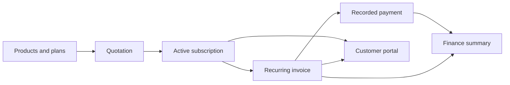

# Subscription Management System

Odoo × FLUX Lucknow Hackathon ’26 · Virtual round

Team leader: **Vyas Devgna** · [@vyas-devgna](https://github.com/vyas-devgna)

Build a single place for Brightloop Software to manage products, plans, subscriptions, recurring invoices, payments, and revenue. Customers need a portal for their own subscriptions and invoices.

**Status:** The problem has been selected and the repository link submitted. This repository currently contains the implementation plan; the application and its setup instructions have not been added yet.

## Start here

- [Official problem statement](https://hackathon.odoo.com/web/content/215872?download=true)
- [Requirements and acceptance checks](docs/REQUIREMENTS.md) — what the brief asks for and what remains a team decision.
- [Architecture](docs/ARCHITECTURE.md) — proposed stack, data, permissions, billing, and integration boundaries.
- [Round plan and contribution workflow](docs/ROUND_PLAN.md) — implementation order, team slices, checks, and submission.

The proposed stack is Django 5.2 LTS, server-rendered templates, and SQLite for the round. The team should add runnable setup instructions with the first application scaffold, including how to run migrations, email, and the billing scheduler. No payment gateway is required by the detailed payment-recording scenario.

## Contributing

Work on `main` and coordinate changes to shared files. Each teammate should use their own GitHub-linked identity, write clear commit messages, and push their own work regularly. Keep credentials, local databases, and environment files out of Git. See the [round plan](docs/ROUND_PLAN.md) for the shared workflow.
