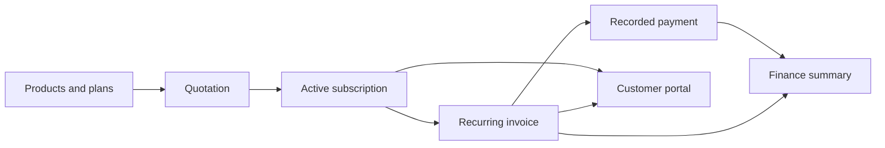

# Subscription Management System

Lucknow Hackathon ’26 · Virtual round

Team leader: **Vyas Devgna** · [@vyas-devgna](https://github.com/vyas-devgna)

Build a single place for Brightloop Software to manage products, plans, subscriptions, recurring invoices, payments, and revenue. Customers need a portal for their own subscriptions and invoices.

**Status:** Working application: accounts and roles, catalogue, quotations to subscriptions, idempotent recurring billing, discounts, taxes, payments, customer portal and finance dashboard.



## Start here

- Problem statement: the organiser's Subscription Management System brief (4 pages).
- [Requirements and acceptance checks](docs/REQUIREMENTS.md) — what the brief asks for and what remains a team decision.
- [Architecture](docs/ARCHITECTURE.md) — proposed stack, data, permissions, billing, and integration boundaries.
- [Round plan and contribution workflow](docs/ROUND_PLAN.md) — implementation order, team slices, checks, and submission.

The proposed stack is Django 5.2 LTS, server-rendered templates, and SQLite for the round. The team should add runnable setup instructions with the first application scaffold, including how to run migrations, email, and the billing scheduler. No payment gateway is required by the detailed payment-recording scenario.

## What's inside

- **Sales:** customers (CSV import, statements), product variants, per-product tax rules, plans with close/pause/renew controls, quotation templates, quotations emailed and printable, a list and pipeline board, seat changes on live subscriptions with optional prorated adjustment invoices, add-ons.
- **Billing:** idempotent billing runs (manual, scheduled, or catch-up), optional auto-confirm/auto-email, discounts (fixed/percent, whole subscription or selected products, limits and windows), taxes, bulk confirm/send/remind/cancel, replacement invoices, refunds, dunning reminders, renewal notices.
- **Money in:** payments by method with notes, quick-payment panel, customer "Pay now" (test-mode checkout; no card data stored), aged receivables.
- **Finance:** collection meters, MRR/ARR trend, churn and net-new, top customers, billing calendar, CSV exports.
- **Navigation:** top tabs, Ctrl+K command palette, live notifications, grouped history lists, sortable tables, dark mode, mobile layout.
- **Trust:** roles, ownership-scoped customer portal, append-only audit log, login throttling, backups, health check.

## Run it

```sh
uv venv .venv && uv pip install -r requirements.txt
.venv/bin/python manage.py migrate
.venv/bin/python manage.py seed_demo          # demo data, replayed through the real billing engine
.venv/bin/python manage.py runserver
```

Logins: `admin@brightloop.test / Admin@12345`, `staff@brightloop.test / Staff@12345`, customer portal `maya@acme.test / Customer@123`.

- **Billing scheduler:** `manage.py run_billing` (idempotent, catches up after downtime, single-instance lock). Cron example: `*/15 * * * * cd /path && .venv/bin/python manage.py run_billing`, or `run_billing --every 900`. It can also be triggered from Billing runs in the UI.
- **Email:** console backend by default. Set `EMAIL_HOST`, `EMAIL_PORT`, `EMAIL_HOST_USER`, `EMAIL_HOST_PASSWORD` for real SMTP (reset links, invoice sending).
- **Tests:** `manage.py test` (password rules, roles, idempotent billing, discounts, payments, portal isolation).
- **Performance:** `seed_demo --bulk 5000` then `perf_check`. On a laptop with 5,010 subscriptions and 17,875 invoices, every key page responded in under 100 ms (budget 2 s).
- **Policies:** money is `Decimal` rounded half-up to paise; billing anchors to the start day (31 Jan, 28 Feb, 31 Mar); one best discount per invoice, applied before tax; cancelling an invoice returns its discount use; overpayment is rejected; add-on changes apply from the next invoice; renewal creates a linked new subscription.

## Contributing

Work on `main` and coordinate changes to shared files. Each teammate should use their own GitHub-linked identity, write clear commit messages, and push their own work regularly. Keep credentials, local databases, and environment files out of Git. See the [round plan](docs/ROUND_PLAN.md) for the shared workflow.
