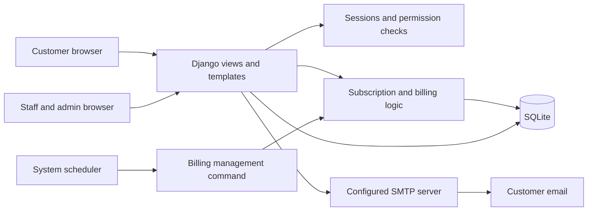
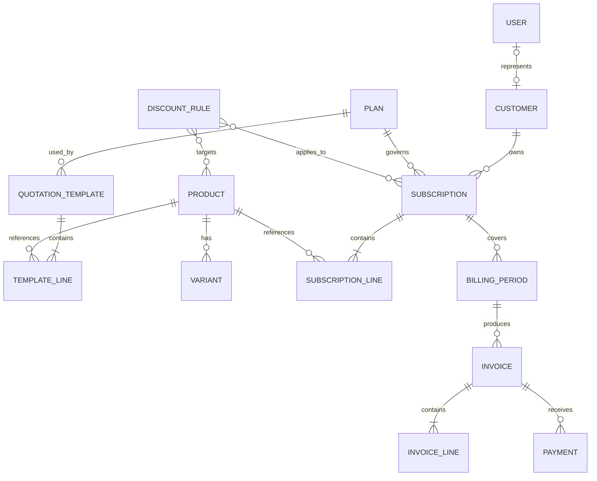
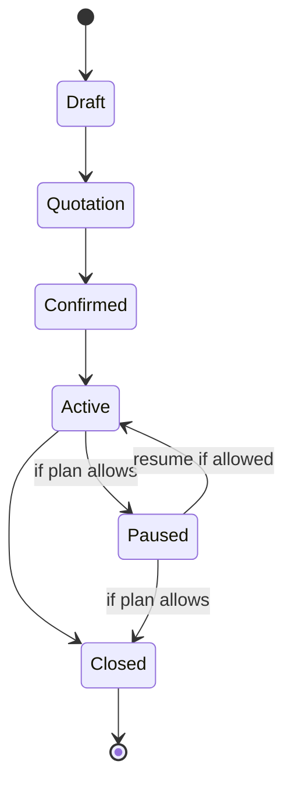
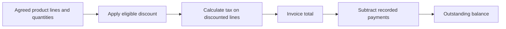
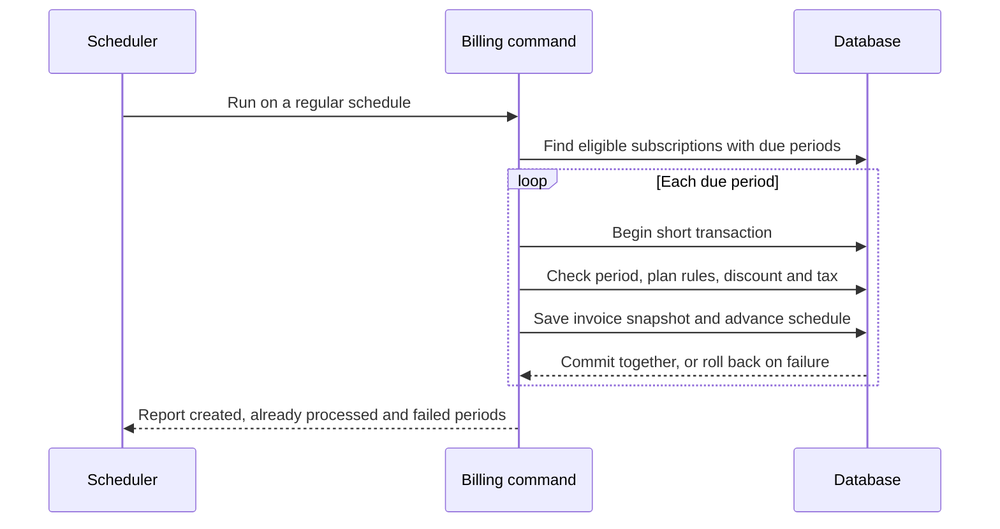

# Architecture and policies

**Status:** implemented. The first part of this document records the policies the code enforces (and the tests that prove them). The later sections are the original design notes, kept where they still apply.

## Implemented policies

| Topic | Rule | Where / proof |
|---|---|---|
| Money | `Decimal`, rounded half-up to 0.01 once per stored amount (`core.money.q`). Never floats. | `core/money.py`, `test_billing`, `test_payments` |
| Calendar | Periods are computed from the **start-date anchor**, never from the previous period: 31 Jan → 28 Feb → 31 Mar; 29 Feb + 1 year → 28 Feb; daily/weekly add exact days. Timezone `Asia/Kolkata`; dates only. | `subscriptions.models.add_interval`, `Calendar` tests |
| Billing identity | A `BillingPeriod` row is unique per (subscription, index); an ordinary invoice is unique per (subscription, period start). A crash between invoice and schedule update is repaired by the next run (`skipped`). | `billing/engine.py`, `Idempotency` tests |
| Concurrency | Per-subscription transaction; PostgreSQL uses `SELECT … FOR UPDATE SKIP LOCKED`; SQLite serialises writers (`BEGIN IMMEDIATE`, WAL). A runner that loses a lock skips and the next run completes it. | `Concurrency` test (threads) on SQLite and PostgreSQL |
| Pricing | The plan price pre-fills **one** base line (tiered by quantity); products are priced from the catalogue. The plan is never charged twice. One-time lines bill on the first period only and are excluded from MRR. | `subscriptions/services.create_subscription`, `billing/pricing.py` |
| Discounts | One best eligible rule per invoice (no stacking). Applied **before** tax. Fixed amounts are allocated proportionally across eligible lines, remainder on the last. A use is claimed atomically and tied to the invoice; cancelling an unpaid invoice gives the use back and a replacement claims it again. | `billing/pricing.py`, `Discounts` tests |
| Tax | Per-line rule: product tax, else default tax valid on the quote date. Exclusive: tax = net × rate. Inclusive: the listed price contains the tax and is carved out. Not a statutory-compliance engine. | `Taxes` tests |
| Invoice lifecycle | Draft → Confirmed (locks the amounts) → Paid; Cancelled is terminal. A locked invoice rejects edits to amounts, period or parties at the model level. Corrections are **credit notes** (negative documents linked to the original) or an explicit **replacement**. | `Invoice.save`, `Snapshots` test |
| Contract lifecycle | Draft → Quotation → Confirmed → Active → Closed, plus Paused and Cancelled (rejected/expired quotation). Transitions are guarded in `subscriptions/services.py` for staff and portal alike; plan flags (pause, early close, renew, self-service, minimum term, cancellation timing) are enforced there. | `Lifecycle` tests, `PortalIsolation` |
| Amendments | Previewed before commit: today vs after, MRR before/after, proration of the **remaining days of the paid period** (`days_left / days_in_period`, each line rounded), amount due now or credit, next billing amount. Immediate changes bill an adjustment invoice (increase) or issue a credit note (decrease); if the period's invoice is still a draft it is regenerated instead. "Next period" changes are stored and applied by the billing run. Plan changes must keep the billing frequency. | `Changes` tests |
| Renewal | New linked term, never a reopened record. Renewal quotation (customer decides) or confirmed renewal; plans can auto-renew at expiry; closing a renewed term nets to zero in MRR. | `Lifecycle`, `Movements` tests |
| Payments | Payments apply only to confirmed invoices, never exceed the balance, are idempotent (`idempotency_key`, `(provider, provider_ref)`), and have statuses. Customer-reported payments stay **pending** until staff match them to a statement. Failed payments never touch balances. Refunds are negative payments and cannot exceed what was paid. | `test_payments` |
| Provider | Hosted checkout only. Money is recorded from signature-verified webhooks or an explicit reconcile call, never from a browser redirect. Events are deduplicated by id; a provider outage records nothing. No automatic retries exist, so an ambiguous outcome can never double-charge; links are refused while a payment is awaiting confirmation. Sandbox keys mark payments `is_test`, excluded from revenue. | `Provider` tests |
| Permissions | Roles (admin / staff / customer) + staff capabilities (sales, billing, finance, catalogue). Every view/action checks server-side; portal querysets are filtered by owner so other customers' ids return 404. | `Authorisation`, `PortalIsolation` |
| Reporting | Recurring revenue comes from effective-dated `SubscriptionChange` rows, so history is never recomputed from today's state. Definitions in [METRICS.md](METRICS.md). | `test_reports` |
| Email | Outbox first, delivery after commit, exponential backoff, dedupe keys. Mail failure never blocks billing. | `OutboxTests` |

## Original design notes

The official brief takes precedence when it conflicts with a proposal here. Record any changed decisions in this document before teammates build against different assumptions.

## Stack

| Layer | Choice | Reason |
| --- | --- | --- |
| Application | Python and Django 5.2 LTS | One codebase with forms, ORM, sessions, permissions, admin, and email support. |
| Interface | Django templates, responsive CSS, and small amounts of JavaScript | A single server renders the staff interface and customer portal. Bootstrap may be bundled locally if the team wants it. |
| Database | SQLite for the round | Easy local setup and persistent dynamic data. Each developer has their own local database. |
| Billing | Django management command, invoked by one system scheduler | A separate scheduled process runs even when nobody is viewing the website. |
| Email | Django email with SMTP | Real delivery is needed for reset links and invoice sending; console email is for local development only. |
| Invoice output | HTML and browser print styles | A printable invoice without a separate PDF service. |

Django 5.2.8 or later supports Python 3.14; pin a tested 5.2 patch release when the scaffold is added. See [Django 5.2 compatibility](https://docs.djangoproject.com/en/5.2/releases/5.2/). No paid service or API key is part of this plan.

The scheduler is a separate operating-system process. The web server alone does not start it. If the machine is off, overdue work runs when the scheduler resumes; a manual command can assist an operator but does not replace scheduling.

## Suggested code boundaries

These are proposed responsibilities, not files that already exist. A small team can use fewer Django apps if that makes integration easier; agree on shared models and service interfaces first.

| Area | Responsibility | Main collaborators |
| --- | --- | --- |
| Accounts | User model, signup, login, reset, roles, customer ownership | Portal and staff views |
| Catalogue | Products, variants, plans, taxes, quotation templates, discounts | Subscriptions and billing |
| Subscriptions | Customers, quotations, subscription lines, lifecycle, add-ons | Catalogue, billing, portal |
| Billing | Billing periods, invoices, discounts, tax calculations, payments | Subscriptions and reporting |
| Presentation | Staff screens, customer portal, finance summary, print layout | All areas through shared services |

Use server-side permission checks for every protected action and record. Django admin can accelerate internal configuration, but the customer portal needs its own ownership-filtered views. Do not depend on hidden buttons as authorization.

## Data relationships

The diagram shows conceptual relationships. It is not a final database schema: a quotation and subscription may share a record if the team can preserve the required states and fields clearly.

Store plan configuration separately from each customer's subscription. A subscription line records the agreed product, variant, quantity, and price. An invoice stores a snapshot of its customer, period, lines, discount, tax, and totals so later catalogue changes do not rewrite past bills. Keep a record of discount use tied to the relevant invoice or billing period.

| Record | Minimum information to agree on |
| --- | --- |
| User and customer | Normalized unique email, password hash and role; customer identity and the optional linked login. Staff can prepare a quote before a customer has signed up. |
| Product and variant | Name, type, sale and cost prices, notes; variant label and price adjustment. |
| Plan | Price, billing interval, minimum quantity, availability dates, and close/pause/renew settings. |
| Tax and discount | Tax rule; discount type and value, eligibility threshold, dates, usage limit, and product or subscription scope. |
| Quotation template | Plan, default product lines, and validity in days. |
| Subscription and lines | Number, customer, plan, dates, payment terms, state, next due date; product, variant, quantity, unit price, tax and line amount. |
| Billing period and invoice | Subscription, covered dates and processing outcome; invoice number, state, due date, line and total snapshots, and any canceled/replacement relationship. |
| Discount use and payment | Applied rule, invoice or period and amount; invoice, payment method, amount, date, and note. |

The owner of each model should publish the final fields and migrations before another slice depends on them. Validate quantities, amounts, date ranges, and role changes on the server as well as in forms.

Create the custom user model and set `AUTH_USER_MODEL` **before the first migration**. Normalize email consistently and enforce uniqueness in the database as well as the form. Django recommends setting the custom model before the first migration. [Django custom-user guidance](https://docs.djangoproject.com/en/5.2/topics/auth/customizing/#using-a-custom-user-model-when-starting-a-project).

## Lifecycle and permissions

The five named states follow the brief. `Paused` is a proposed additional operational state; the team can use a flag instead. Define renewal as an explicit action that updates or creates a clearly linked subscription term; do not silently reopen a closed record. Plan permissions must be enforced on the server for staff and customer actions.

For invoices, retain the brief's Draft → Confirmed → Paid progression. Represent **Canceled** separately as a terminal state so it is not counted as outstanding. A partially paid invoice remains confirmed with a remaining balance; it becomes paid only when the balance is zero. These are proposed interpretations of areas the brief does not fully specify.

| Action | Admin | Internal staff | Customer |
| --- | --- | --- | --- |
| Configure products, plans and taxes | Yes | Limited by assigned permissions | No |
| Create discount rules and add staff | Yes | No | No |
| Handle quotations, invoices and payments | Yes | As permitted | Own records only where a customer action is provided |
| View and manage a subscription | Yes | As permitted | Own subscription, within plan rules |

The staff permission details are a proposal; the brief states that staff access is limited but does not enumerate every permission. Always check customer ownership in the query itself.

## Prices, discounts, and tax

Use integer minor units for stored monetary amounts; for the round, INR/paise is a proposed single-currency assumption, not a requirement in the brief. Calculate percentages with exact arithmetic and a documented rounding rule; do not use binary floating point for money. SQLite has no native exact decimal type and has limited write concurrency. [Django's SQLite notes](https://docs.djangoproject.com/en/5.2/ref/databases/#sqlite-notes).

Proposed pricing rule: the plan price pre-fills the base subscription line; the chosen variant adjusts that line, and enabled add-ons have their own lines. The plan is not charged a second time as a separate fee. A quotation stores the agreed line prices, and generated invoices snapshot those values.

Proposed discount rule: attach one eligible discount to a subscription; it can target eligible product lines or the whole subscription. Calculate the discount before tax, never below zero, then calculate tax on the discounted lines. For a whole-subscription discount, allocate any fixed discount across eligible lines deterministically so the per-line taxes and displayed total agree. Document the rounding and allocation rules in the implementation. Stacking discounts is outside this initial policy.

Check eligibility and available usage when an invoice is created for its billing date. Save the applied rule, calculated amount, and usage record with that invoice in the same transaction. Decide and document how cancellation and a replacement invoice affect a usage limit; neither a retry nor a replacement should silently consume the same use twice.

For a concrete calculation, assume a monthly plan line costs ₹1,000 per unit, a variant adds ₹560 per unit, quantity is two, a 10% subscription discount applies, and a hypothetical 18% tax applies to that line. The 18% rate is an example, not a tax rule prescribed by the brief.

| Step | Amount |
| --- | ---: |
| Two units at ₹1,560 | ₹3,120.00 |
| 10% discount | −₹312.00 |
| Discounted subtotal | ₹2,808.00 |
| 18% tax | ₹505.44 |
| Invoice total | ₹3,313.44 |
| Remaining after a ₹1,000 payment | ₹2,313.44 |

## Recurring billing

- Store a billing period and next due date for each subscription. Support daily, weekly, monthly, and yearly intervals.
- Use a database-backed uniqueness rule for an ordinary invoice per subscription and period, plus a transaction for the period, invoice, discount use, and next-due update. A retry must be harmless, including after a partial failure.
- A canceled invoice remains in the period history. Do not automatically recreate it on every scheduler run; make any replacement an explicit operation with a recorded link to the canceled invoice.
- Process overdue periods after downtime, without billing paused or closed subscriptions contrary to the chosen policy. Log failures so they can be retried and investigated.
- Use one scheduler for SQLite, prevent overlapping command runs, keep transactions short, and use bounded retries for lock errors. Database uniqueness and transactional checks remain necessary even with a single scheduler. SQLite does not implement `select_for_update()`; do not rely on it for locking. If concurrent writes become a problem, move the same Django models to PostgreSQL and revisit locking. [Django SQLite locking guidance](https://docs.djangoproject.com/en/5.2/ref/databases/#database-is-locked-errors).

Proposed calendar policy: use `Asia/Kolkata` for the round, treat dates consistently, and preserve the original day-of-month anchor. If a month has no matching day, use its last day and return to the original anchor when possible: for example, 31 January 2027 → 28 February → 31 March. Make expiry, renewal, pause, and resume behavior explicit before implementation. This is a team policy, not a rule given by the brief.

## Interfaces between slices

Agree on actual names and signatures when the scaffold exists. Each operation below should be implemented once on the server and reused by both the web interface and scheduled command where applicable.

| Operation | Input | Expected result |
| --- | --- | --- |
| Create a subscription from a template | Customer, template, dates, quantities and terms | Draft with agreed line snapshots and a unique subscription number. |
| Change subscription state | Subscription, requested action, actor | Allowed transition and schedule update, or a clear validation error. |
| Generate due invoices | Current time | Due periods processed once, failures reported, and missed periods eligible for later retry. |
| Record a payment | Invoice, amount, date, method, note and actor | Payment saved and remaining balance/status updated together. Reject overpayment under the proposed first-round policy. |
| Build finance summary | Date range and permitted filters | Active subscription count, cash received, outstanding and overdue amounts, plus recurring amounts grouped by billing frequency. |

Keep cash received, amounts invoiced, outstanding balances, and recurring amounts distinct. Report a precise definition for each number; do not label payments as recognized accounting revenue without an accounting policy.

## Security and operational boundaries

- Use Django's password hashing, sessions, CSRF protection, and password reset tools. Add a validator for the brief's password rules and enforce roles and ownership in server-side queries and actions. [Django authentication](https://docs.djangoproject.com/en/5.2/topics/auth/default/).
- Use a configured SMTP server for real reset and invoice emails. The console backend only prints messages locally; do not present it as delivered email. Show or log delivery failures without exposing reset links to other users.
- Keep secrets in environment variables, never in the repo; keep `.env`, the local database, and virtual environments out of Git. Commit migrations and safe sample data needed for a fresh run.
- Store payment records only. The brief does not specify a gateway or require storing card details. Never store card details in this application.
- Index and paginate the queries used for due billing, customer records, invoice status/due date, and summaries. Measure response time with thousands of subscriptions; the chosen stack alone does not prove the under-two-second target.

## External references

- [Django database transactions](https://docs.djangoproject.com/en/5.2/topics/db/transactions/)
- [Django email backends](https://docs.djangoproject.com/en/5.2/topics/email/)
- [OWASP authorization guidance](https://cheatsheetseries.owasp.org/cheatsheets/Authorization_Cheat_Sheet.html) and [password reset guidance](https://cheatsheetseries.owasp.org/cheatsheets/Forgot_Password_Cheat_Sheet.html)
