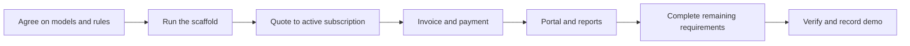

# Round plan and team workflow

The aim is a working, explainable subscription journey backed by persistent data. The [requirements checklist](REQUIREMENTS.md) covers the full brief; the stages below show a sensible order, not permission to omit required features.



## 1. Agree before parallel work

Choose owners for the shared user model, catalogue and subscription models, billing services, and integration. Agree on field names, model relationships, money and date rules, permissions, and who creates each migration. The [architecture](ARCHITECTURE.md) provides proposed defaults. Reconcile any changed decision with the team before building against it.

The first scaffold should include a custom user model **before migrations**, pinned dependencies, a local database configuration, and a README with commands that have actually been tried. Add safe sample data for a fresh run. At present there is no application in the repository, so there are no run commands yet.

## 2. Divide work into slices

Adjust these roles to the actual team size. Each person owns their code and explains their own commits; one person can take more than one slice.

| Slice | Work | Integration point |
| --- | --- | --- |
| Accounts and portal | Signup, login, reset, roles, customer ownership, customer views | Shared user and customer IDs; read subscription and invoice services. |
| Catalogue and sales | Products, variants, plans, tax rules, quotation templates, subscriptions | Publish agreed models and lifecycle actions for billing. |
| Billing and payments | Scheduled due periods, invoice snapshots, discounts, tax, payment records, print/send | Consume agreed subscription lines; expose invoice and balance data. |
| Reporting and integration | Staff navigation, finance summary, filters, responsive layout, integration checks | Read shared models; coordinate migrations and final integration. |

Avoid independent edits to the same model or migration. If an interface must change, tell the affected owner and integrate the change before continuing.

## 3. Build in dependency order

1. **Foundation:** runnable Django project, custom user, database migrations, roles, and base layout.
2. **Sales path:** product and plan configuration, template, quotation, subscription lines, and lifecycle.
3. **Billing path:** due-period calculation, invoice snapshot, tax and discount calculation, payment and balance.
4. **Customer and finance views:** ownership-filtered portal, invoice access, summary, filters, and overdue visibility.
5. **Close gaps:** add-on changes, all plan controls, email delivery, print, edge cases, and the remaining items in the checklist.

Keep the app runnable after each integration. Treat the ten optional additions as later work; the required features and a correct end-to-end flow come first.

## 4. Work safely on shared `main`

Before a work slice, make sure your working tree is clean and get the latest changes:

```sh
git switch main
git pull --ff-only origin main
```

Use your own GitHub-linked Git identity. Coordinate shared files, review your changes, then make a focused commit and push it:

```sh
git add path/to/your/files
git commit -m "Describe the contribution"
git push origin main
```

If a push is rejected because someone else pushed first, stop and coordinate integration; do not force-push or rewrite another person's published commits. Keep each teammate's contributions visible. The organizer's email asks for regular pushes at least hourly and the latest code on `main`.

## 5. Verification before the demo

Use the [requirements checklist](REQUIREMENTS.md) as the coverage list. At minimum, demonstrate these paths against the integrated application:

1. Sign up and log in; reject a duplicate email and an invalid password. Confirm a customer cannot read another customer's data.
2. Configure a product, variant, plan, tax, discount, and template; create a quotation and activate a subscription.
3. Generate a due invoice, verify its lines and totals, rerun billing without a duplicate, and check an expired or exhausted discount.
4. Confirm, send, and print an invoice; record a payment; check the outstanding balance, overdue view, and finance summary.
5. Check the allowed pause/renew/close actions and an add-on change. Refresh pages to show the data persists.
6. Measure page responses using thousands of subscriptions and record the machine, dataset, and results. Check both desktop and mobile layouts.

Also check that the scheduler is running and can catch up after a stopped interval; the web server alone does not schedule billing. Verify actual SMTP delivery for the reset link and invoice email when demonstrating those requirements. The Django console backend is useful locally but does not send email.

## 6. Submission and demo

The team dashboard showed the selected statement and the submitted public repository link. Confirm that the evaluator has accepted the collaborator invitation. The organizer's timeline lists coding ending at **5:00 PM IST** and video submission at **5:30 PM IST** on 31 October 2026; follow the live portal if it changes. The organizer's email requests an open-access video showing the functional flow, with a maximum duration of 5–6 minutes. Aim for five minutes, confirm access in a private browser window, and verify the portal shows the submitted link.

Suggested demo: configure a product and plan, create a quotation and subscription, generate an invoice, record a payment, show the customer portal, then show the finance summary. Present only behavior that actually works. Each teammate should be ready to explain their own code and commits.
